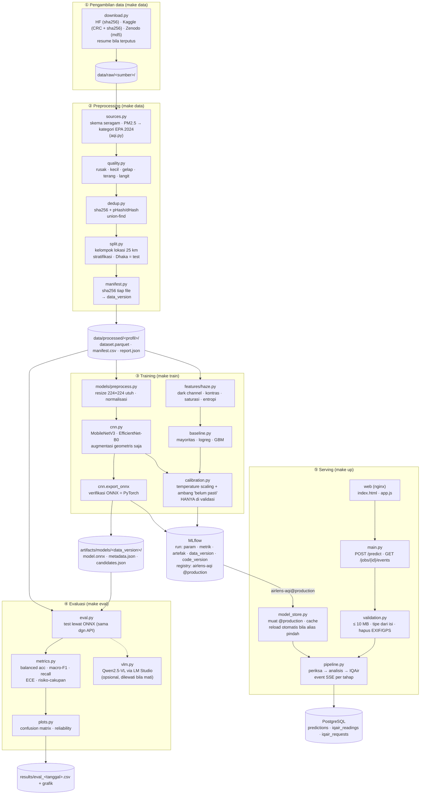
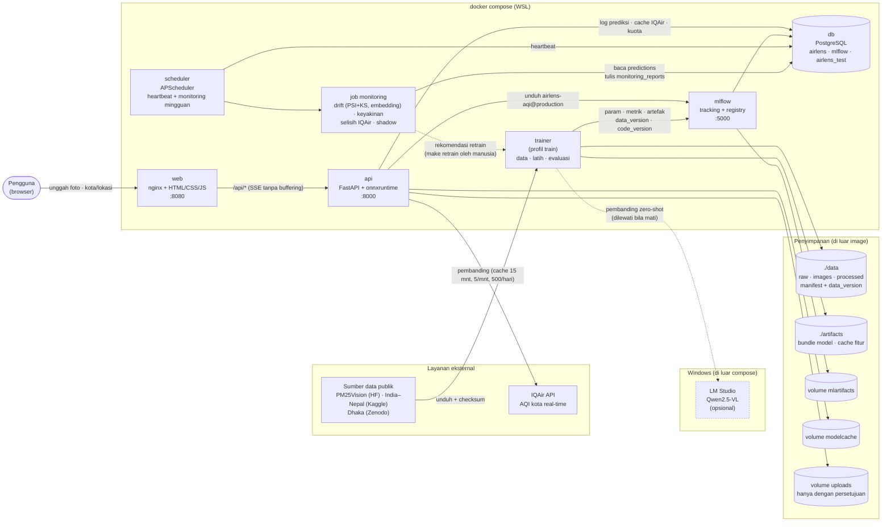
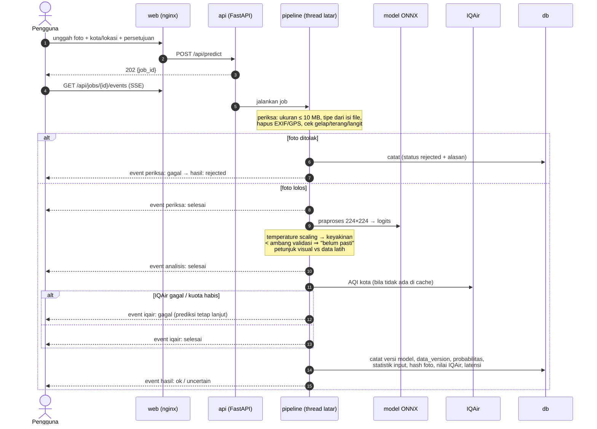
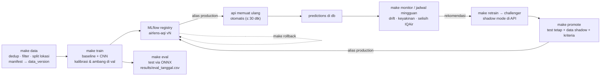

# Arsitektur AirLens

Diagram ini menggambarkan sistem **sebagaimana kodenya sekarang** (Fase S–5). Garis putus-putus menandai komponen
opsional (LM Studio). Port host: web 8080, api 8000, mlflow 5000; db tidak dibuka ke host.

## 1. Pipeline: dari pengambilan data sampai model di-serve

Setiap kotak menyebut file kode yang mengerjakannya dan keluarannya. Dijalankan berurutan oleh
`make data` → `make train` → `make eval` (layanan `trainer`), lalu disajikan oleh layanan `api` dan `web`.

## 2. Komponen dan layanan

## 3. Alur satu prediksi (`POST /predict`)

Setiap tahap mengirim event Server-Sent Events saat **benar-benar** terjadi di pipeline (tidak ada timer palsu).

## 4. Siklus model (MLOps)

## Catatan

- **Laptop vs lab:** kode identik; perbedaan hanya lewat `APP_PROFILE` (`config/laptop.yaml` / `config/lab.yaml`) dan
  `compose.gpu.yaml` (trainer dengan PyTorch CUDA 12.6 dan GPU NVIDIA).
- **Test:** layanan `tests` (profil `test`) menjalankan pytest terhadap database `airlens_test`; `make ui-test`
  menjalankan Chrome headless terhadap layanan `web`.
- Keputusan dan alasannya: `DECISIONS.md`. Data, lisensi, dan batasan: `DATA_CARD.md`.
