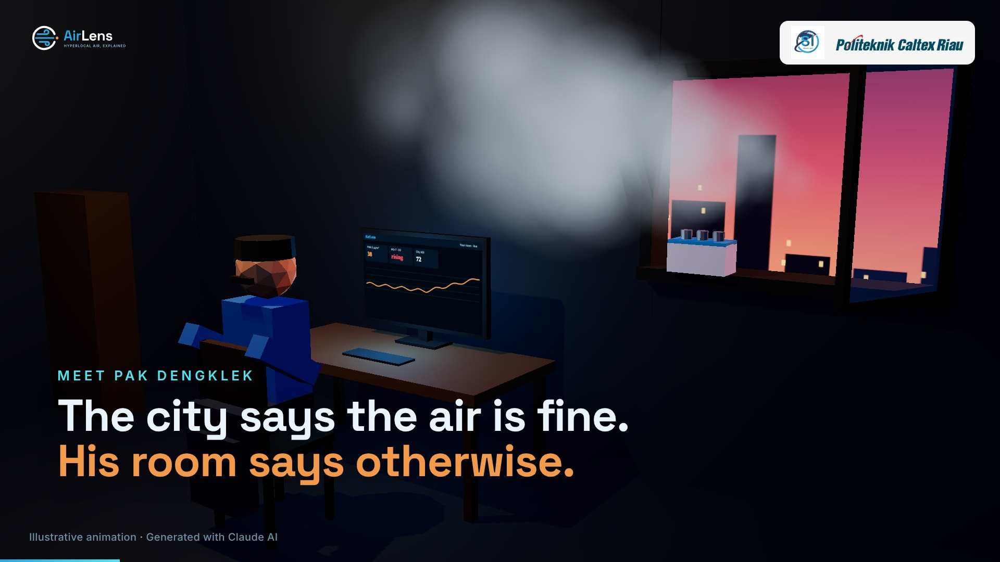
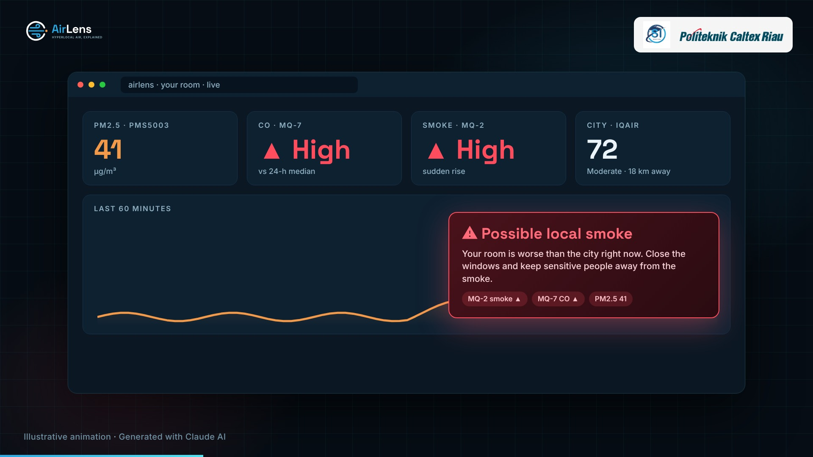
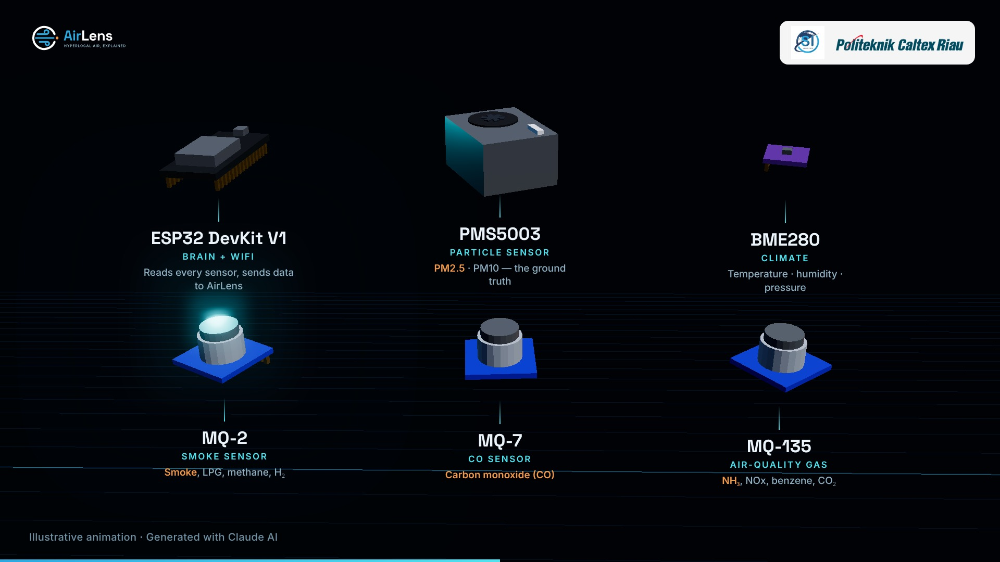
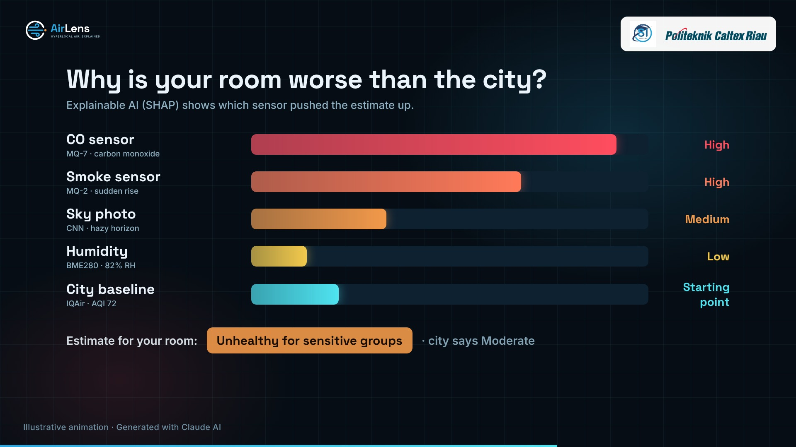
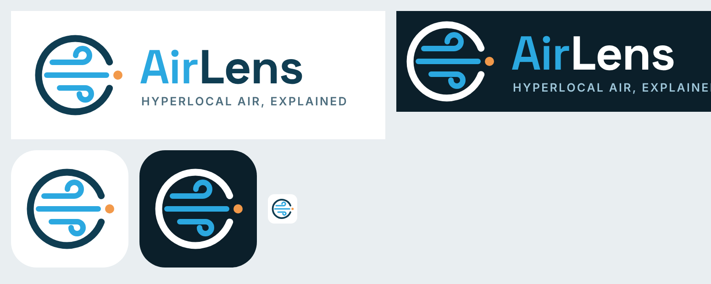
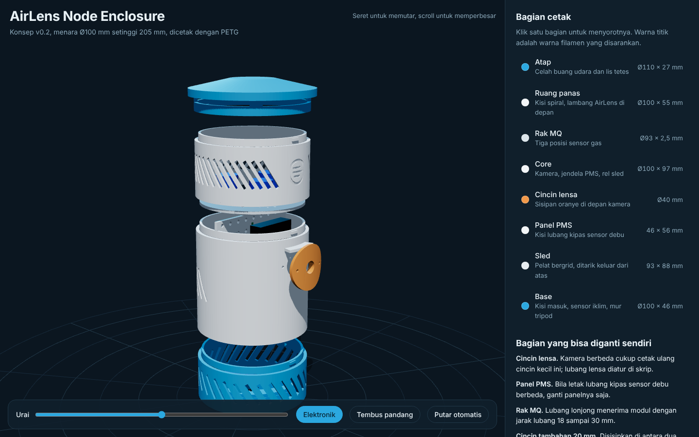

# AirLens v2: Dokumen Penjelasan Lengkap

Dokumen ini merangkum seluruh keputusan, rancangan, dan berkas yang dibuat untuk AirLens v2 setelah evaluasi lab pada 20 November 2026: hasil lab, revisi 3 kelas, rancangan node sensor dengan kamera kejadian, penanganan gas tak terlihat, Explainable AI, video booth, logo, dan casing cetak 3D. Bagian terakhir berisi langkah unggah manual ke GitHub.

Dokumen ini melengkapi `docs/Revisi_AirLens_v2.docx`. Bila ada perbedaan, dokumen inilah yang lebih baru (lihat bagian 3.6).

> Status setiap bagian ditandai dengan salah satu label berikut:
> **Selesai** (sudah ada dan teruji), **Rancangan** (disepakati, belum dibuat), **Menunggu** (butuh bahan atau keputusan dari tim).

---

> **Catatan status (2026-11-22).** Lingkup proyek sekarang: (1) **proyek utama**: foto pengguna → tingkat kualitas
> udara (Low/Elevated/High) dengan IQAir sebagai pembanding; (2) **tambahan**: alat IoT AirLens Beta (ESP32 + 4 MQ)
> dengan model gas dan **SHAP**. Grad-CAM, kamera live, dan model asap **tidak dipakai**. Bagian rancangan v2 di bawah
> (model fusi, kamera kejadian, Grad-CAM) disimpan sebagai catatan sejarah; keputusan terkini ada di DECISIONS.md.

## Daftar isi

1. [Ringkasan](#1-ringkasan)
2. [Hasil lab 20 November 2026](#2-hasil-lab-20-november-2026)
3. [Revisi 3 kelas yang sudah ada di repo](#3-revisi-3-kelas-yang-sudah-ada-di-repo)
4. [Rancangan v2: node sensor + kamera kejadian](#4-rancangan-v2-node-sensor--kamera-kejadian)
5. [Gas yang tidak terlihat dan empat jenis kejadian](#5-gas-yang-tidak-terlihat-dan-empat-jenis-kejadian)
6. [Explainable AI: SHAP saja](#6-explainable-ai-shap-saja-keputusan-2026-11-22)
7. [Notifikasi di website](#7-notifikasi-di-website)
8. [Privasi kamera](#8-privasi-kamera)
9. [Pengumpulan data sebelum pameran](#9-pengumpulan-data-sebelum-pameran)
10. [Rencana kerja (fase 8a–8g)](#10-rencana-kerja-fase-8a8g)
11. [Persiapan hari pameran](#11-persiapan-hari-pameran)
12. [Video booth](#12-video-booth)
13. [Logo AirLens](#13-logo-airlens)
14. [Casing cetak 3D](#14-casing-cetak-3d)
15. [Usulan catatan untuk DECISIONS.md](#15-usulan-catatan-untuk-decisionsmd)
16. [Struktur folder baru di repo](#16-struktur-folder-baru-di-repo)
17. [Langkah unggah manual ke GitHub](#17-langkah-unggah-manual-ke-github)
18. [Daftar periksa berikutnya](#18-daftar-periksa-berikutnya)

---

## 1. Ringkasan

**Masalah v1.** AirLens v1 memperkirakan kategori AQI dari satu foto. Dosen menilai keluaran itu tidak memberi nilai tambah, karena IQAir dan situs lain sudah memberi angka AQI dan saran yang sama dari stasiun pemantau yang lebih akurat. Dosen menyarankan Explainable AI (XAI) dan sensor gas/asap seri MQ.

**Posisi v2.** AirLens v2 tidak lagi bersaing menampilkan angka AQI kota. Angka IQAir dipakai sebagai **baseline**, titik awal yang harus dikoreksi oleh data di sekitar pengguna. AirLens v2 menjawab tiga pertanyaan yang tidak dijawab IQAir:

1. Apakah udara di titik saya berbeda dari angka kota? (sensor dan kamera di sekitar pengguna)
2. Mengapa? (XAI: sensor mana yang paling berpengaruh)
3. Ini asap lokal, gas tak terlihat, debu, atau kabut regional? (kombinasi sensor dan kamera)

**Tujuan akhir.** Proyek didemokan di pameran proyek mata kuliah di kampus. Prioritas desain mengikuti hal itu: apa yang bisa dilihat pengunjung dalam beberapa menit (demo asap, notifikasi, peta panas Grad-CAM) didahulukan, sementara siklus MLOps ditunjukkan untuk penilai.

---

## 2. Hasil lab 20 November 2026

**Status: Selesai.**

`make lab-all PROFILE=lab` berhasil pada percobaan ketiga (log di `logs/lab_20261120_*`):

| Percobaan | Hasil | Keterangan |
|---|---|---|
| 1 (13:58) | Gagal di tahap `layanan` (kode 255) | Isi log `.log` tidak di-commit, jadi penyebab pastinya tidak diketahui |
| 2 (13:59) | Gagal di tahap `migrasi` (kode 2) | Sama seperti di atas |
| 3 (14:12) | Semua tahap selesai | Total ±40 menit |

Durasi percobaan ketiga (dari `timings.tsv`):

| Tahap | Durasi |
|---|---|
| setup-check | 18 detik |
| layanan (db + mlflow) | 1 menit 23 detik |
| migrasi (termasuk build image) | 9 menit 21 detik |
| data | 3 menit 33 detik |
| train | 23 menit 22 detik |
| eval | 1 menit 31 detik |
| export | 14 detik |

Kesimpulan: seluruh alur jauh lebih singkat dari sesi lab ±4 jam, jadi ada sisa waktu untuk eksperimen tambahan.

Yang dilewati: evaluasi Qwen2.5-VL (LM Studio tidak terjangkau dari container) dan set uji Indonesia (belum dibuat, fase 2b opsional).

---

## 3. Revisi 3 kelas yang sudah ada di repo

**Status: Selesai di kode (commit `e5583a7`), dengan dua catatan Menunggu.**

### 3.1 Apa yang berubah

- Kelas digabung menjadi tiga: `good → moderate`, `usg → unhealthy`, `hazardous → very_unhealthy`. Penggabungan selalu ke kelas yang **lebih buruk**, agar saran kesehatan bersifat hati-hati.
- Skema kelas disimpan di metadata model (`class_merge`), sehingga rollback ke model 5 kelas lama tetap ditampilkan dengan benar (`merge_for_classes` di `src/airlens/aqi.py`).
- `promote.py` menolak promosi bila skema kelas challenger berbeda dari production.
- Website menampilkan **dua kandidat teratas** saat hasil belum pasti, lengkap dengan peluang gabungannya.
- `compare_merge.py` dibuat untuk perbandingan yang adil antara model 5 kelas (probabilitas dijumlahkan) dan model 3 kelas pada split yang sama.

**Nama tiga tingkat (Tahap 4, 2026-11-22).** Kelas gabungan diberi nama baru agar tidak tertukar dengan kategori
IQAir: **Low / Rendah** (AQI 0–100, Good + Moderate), **Elevated / Meningkat** (101–200, USG + Unhealthy), **High /
Tinggi** (201+, Very unhealthy + Hazardous). Id kelas `low`, `elevated`, `high`. Satu sumber kebenaran:
`src/airlens/tiers.py` (label, rentang, saran, warna, pemetaan EPA → tingkat), dipakai trainer, API, monitoring, dan
website. Model 3 kelas bernama lama (`moderate`/`unhealthy`/`very_unhealthy`, penggabungan sama) tetap ditampilkan
dengan nama baru; model 5 kelas tetap tampil sebagai kategori EPA aslinya. Pembanding IQAir memetakan AQI kota ke
tingkat yang sama (batas 100/101 dan 200/201).

### 3.2 Hasil evaluasi (test)

| Model | Skema | n test | Macro-F1 | Porsi "belum pasti" |
|---|---|---|---|---|
| EfficientNet-B0 | 5 kelas | 1.615 (PM25Vision saja) | 0,375 | 96,9% |
| MobileNetV3-Large | 5 kelas | 1.615 | 0,372 | 96,9% |
| EfficientNet-B0 | 3 kelas | 1.686 (termasuk Dhaka 915) | 0,573 | 38,4% |
| MobileNetV3-Large | 3 kelas | 1.686 | 0,522 | 51,1% |
| Prediktor mayoritas | 3 kelas | 1.686 | 0,211 | 0% |

### 3.3 Catatan penting untuk laporan

1. **Perbandingan 5 vs 3 kelas di tabel di atas belum adil.** Set test-nya berbeda: test 5 kelas tidak berisi Dhaka, sedangkan test 3 kelas berisi 915 foto Dhaka. Kenaikan 0,375 → 0,573 belum boleh diklaim sebagai efek penggabungan kelas. **Menunggu:** jalankan `compare_merge.py` di lab dan commit `results/compare_merge_3class.json`.
2. **Dhaka adalah kota yang tidak pernah dilihat model.** EfficientNet di Dhaka: macro-F1 0,474 (mayoritas: 0,214). Kelas paling berbahaya (`very_unhealthy`) hanya terdeteksi 7 dari 33 foto (21%). Ini temuan penting tentang batas generalisasi model foto.
3. **Akurasi ±1 kelas tidak bermakna untuk 3 kelas.** Nilainya sekitar 95%, tetapi dengan tiga kelas hampir semua tebakan otomatis "meleset paling jauh satu kelas". Jangan dipakai sebagai argumen.
4. **Menunggu:** keputusan 3 kelas belum ditulis di `DECISIONS.md`, padahal komentar di `config/*.yaml` merujuk ke sana. Usulan teksnya ada di bagian 15.

### 3.4 Langkah di lab untuk perbandingan adil

```bash
cd ~/AirLens
# cari folder bundle model lama (5 kelas) dan baru (3 kelas)
ls artifacts/models/
docker compose -f compose.yaml -f compose.gpu.yaml --profile train run --rm trainer \
  python -m airlens_trainer.compare_merge artifacts/models/<data_version_5kelas>/<model> artifacts/models/<data_version_3kelas>/<model>
cat results/compare_merge_3class.json
```

Ganti `<...>` dengan nama folder yang muncul di `ls`. Pastikan kedua bundle adalah arsitektur yang sama (misalnya EfficientNet-B0).

### 3.5 Hubungan dengan rancangan v2

Model foto tetap dipakai di v2, tetapi perannya berubah dari "satu-satunya sumber jawaban" menjadi **salah satu fitur** model fusi dan sumber peta panas Grad-CAM.

### 3.6 Ketidaksesuaian dengan Revisi_AirLens_v2.docx

`docs/Revisi_AirLens_v2.docx` masih memakai angka 5 kelas (97% "belum pasti") dan menulis label v2 "5 kelas sama seperti v1". Dokumen ini memakai **3 kelas** mengikuti kode di repo. Tim perlu memilih satu skema untuk label model fusi dan menyamakan kedua dokumen.

---

## 4. Rancangan v2: node sensor + kamera kejadian

> Bagian ini digantikan oleh [AIRLENS_KONSEP_UTAMA.md](AIRLENS_KONSEP_UTAMA.md)

**Status: Rancangan.**

### 4.1 Komponen node

Perangkat dari kampus belum pasti. Daftar ini adalah rencana; label di video dan ukuran casing mengikuti daftar ini.

| Komponen | Peran | Yang dideteksi | Catatan |
|---|---|---|---|
| ESP32 DevKit V1 | Otak + WiFi | – | Membaca semua sensor, menyimpan/mengirim data, memicu kamera |
| ESP32-CAM (OV2640) | Kamera kejadian | Gambar | Tidur total, hanya bangun saat dipicu |
| PMS5003 | Sensor partikel | PM1, **PM2.5**, PM10 | Sumber **label** model fusi; tidak boleh jadi fitur |
| MQ-2 | Sensor asap | **Asap**, LPG, metana, H₂ | Bereaksi terhadap banyak gas sekaligus |
| MQ-7 | Sensor CO | **Karbon monoksida (CO)** | Paling peka CO, tetapi tetap tidak 100% selektif |
| MQ-135 | Gas kualitas udara | **NH₃**, NOx, benzena, CO₂ | Umum dan murah |
| BME280 (atau DHT22) | Iklim | Suhu, kelembapan, (tekanan) | Untuk kompensasi sensor MQ dan PMS |
| Modul microSD | Penyimpanan | – | Menyimpan data sebelum pameran (bagian 9) |
| Catu daya 5 V 2 A | Daya | – | Pemanas tiga MQ saja menyerap ±2,5 W |

**Komponen yang wajib bagus: sensor PM2.5.** PM2.5 dari sensor debu adalah label (kunci jawaban) model fusi. Tanpa sensor PM2.5, model fusi tidak punya target. Label tidak bisa diganti IQAir karena IQAir sudah dipakai sebagai baseline yang harus dikalahkan. PMS5003/PMS7003 atau SDS011 layak; Sharp GP2Y1010 terlalu kasar. Komponen lain boleh kelas bawah.

**Satu batasan:** PMS5003 juga sensor murah, bukan stasiun referensi. Label pun mengandung derau, dan hal ini perlu ditulis di laporan.

### 4.2 Alur utama satu kejadian

1. ESP32 utama membaca semua sensor setiap 60 detik.
2. Bila ada **pemicu** (lihat 4.3), ESP32 utama mengirim sinyal ke ESP32-CAM.
3. ESP32-CAM bangun dari deep sleep, membuang beberapa frame awal (1–2 detik) agar pencahayaan otomatisnya stabil, lalu menyimpan **satu foto kejadian**, dan tidur lagi.
4. Data sensor dan foto kejadian dikirim ke `api` (saat pameran) atau disimpan ke microSD (saat pengumpulan data).
5. Model fusi memperkirakan kategori udara lokal; SHAP menjelaskan faktornya; Grad-CAM menunjukkan bagian foto yang dilihat model foto.
6. Website menampilkan notifikasi, jenis kejadian (bagian 5), penjelasan, dan foto kejadian.
7. Semua dicatat untuk monitoring: versi model, fitur, prediksi, nilai SHAP, baseline, PM2.5 terukur, dan hash foto.

**Alternatif: foto dari pengguna.** Pengguna tetap bisa mengunggah foto sendiri (perilaku v1). Ini dipakai bila pengguna jauh dari node, atau saat pengunjung booth ingin mencoba dengan fotonya sendiri.

### 4.3 Logika pemicu kamera

Kamera **tidak pernah** memotret berkala dan tidak menyimpan foto "sebelum". Hanya foto kejadian yang disimpan. Alasannya hemat energi dan komputasi: ESP32-CAM tidur total di luar kejadian, dan tidak ada AI yang berjalan di perangkat.

Pemicu (nilai ambang disetel dari data validasi, bukan ditebak):

| Pemicu | Contoh aturan awal |
|---|---|
| Asap | Rs/R0 MQ-2 turun tajam dibanding median 24 jam (asap menurunkan resistansi) |
| CO | Rs/R0 MQ-7 turun tajam dibanding median 24 jam |
| Partikel | PM2.5 naik tajam dibanding rata-rata 30 menit terakhir |
| Batas frekuensi | Paling banyak 1 foto per 5 menit, agar kejadian panjang tidak menghasilkan ratusan foto |

### 4.4 Catatan teknis perangkat keras

- Pemanas MQ memakai 5 V, sedangkan ADC ESP32 maksimal 3,3 V. Keluaran analog MQ **wajib** lewat pembagi tegangan.
- MQ perlu pemanasan 24–48 jam pertama. Data selama itu ditandai `warmup_ok = false`.
- R0 setiap MQ dikalibrasi di udara bersih dan dicatat; diulang bila monitoring mendeteksi pergeseran.
- Waktu diambil dari NTP (UTC).
- ESP32-CAM dihubungkan ke ESP32 utama lewat satu pin GPIO (pemicu bangun) dan berbagi catu daya.

---

## 5. Gas yang tidak terlihat dan empat jenis kejadian

> Bagian ini digantikan oleh [AIRLENS_KONSEP_UTAMA.md](AIRLENS_KONSEP_UTAMA.md)

**Status: Rancangan.**

Kamera tidak bisa melihat CO, sensor bisa. Kombinasi sensor dan kamera menghasilkan empat jenis kejadian:

| Kejadian | Gas (MQ-2/7/135) | PM2.5 | Kamera | Pesan di website |
|---|---|---|---|---|
| Asap lokal (bakar sampah) | Naik | Naik | Terlihat kabut | "Local smoke — close windows" |
| **Gas tak terlihat** (genset, kompor, knalpot) | Naik (MQ-7) | Normal | Tampak bersih | "Invisible gas, likely CO — ventilate the room". Prioritas tertinggi |
| Debu (menyapu, konstruksi) | Normal | Naik | Mungkin keruh | "Dust nearby" |
| Kabut regional | Normal | Naik, IQAir juga tinggi | Kabur | "City-wide haze, not local" |

Untuk gas tak terlihat, foto kejadian tetap disimpan sebagai bukti bahwa sumbernya **tidak tampak**. Pesan menggunakan kata "likely" karena sensor MQ tidak selektif (bagian 6.2).

Aturan di atas dimulai sebagai aturan sederhana (rule-based) yang ambangnya disetel di data validasi. Hasilnya ditampilkan sebagai "kemungkinan", bukan kepastian.

---

## 6. Explainable AI: SHAP saja (keputusan 2026-11-22)

**Status: Selesai di kode (AirLens Beta).**

- **SHAP hanya untuk alat Beta**, karena hanya di sana parameternya bermakna: lima angka dari sensor (rasio MQ-2, MQ-3,
  MQ-7, MQ-135 terhadap udara bersih, plus MQ-3/MQ-2). Setiap keputusan model gas dipecah menjadi dorongan tiap angka
  (TreeSHAP persis dari LightGBM), tampil sebagai waterfall SHAP dan kalimat alasan di halaman Beta dan notifikasi.
- **Grad-CAM++ tidak dipakai** (sempat dibuat di Tahap 2, lalu dihapus). Alasan pemilik: peta panas di atas foto tidak
  bermanfaat bagi pengunjung (asap/kabut tebal sudah terlihat mata), tetapi memaksa API memuat PyTorch (memori ±320 MB,
  0,4–3 s CPU per penjelasan). Fitur foto cukup menampilkan petunjuk visual dari fitur kabut (kontras, kecerahan langit,
  saturasi, dark channel) dibandingkan dengan sebaran data latih; itu pengukuran foto, bukan klaim penjelasan model.
- **SHAP tidak dipakai untuk foto**: masukan CNN adalah piksel, jadi SHAP per piksel hanya menghasilkan peta panas yang
  sama mahalnya; SHAP pada model baseline fitur kabut akan menjelaskan model lain, bukan model yang tebakannya tampil.

### 6.1 Batas klaim SHAP tentang gas

Sensor MQ tidak selektif. SHAP menjelaskan **sensor mana yang paling mendorong keputusan model**, bukan kandungan
kimia udara. Tidak bisa diklaim "CO adalah 60% dari gas"; bisa diklaim "faktor terbesar: MQ-135 turun ke 0,72× udara
bersih". Model dilatih dengan data alat lain (MultimodalGasData); rekaman kalibrasi alat sendiri menguji kecocokannya.

---

## 7. Notifikasi di website

> Bagian ini digantikan oleh [AIRLENS_KONSEP_UTAMA.md](AIRLENS_KONSEP_UTAMA.md)

**Status: Rancangan (saran dosen).**

Saat sensor mendeteksi kejadian, **notifikasi muncul di website**, bukan lewat LED di perangkat. Isinya: jenis kejadian, saran tindakan, sensor yang memicu, dan foto kejadian bila ada.

Secara teknis, website v1 sudah memakai Server-Sent Events (SSE) untuk tahap analisis foto (`GET /jobs/{id}/events`). Pola yang sama bisa dipakai untuk aliran notifikasi kejadian, misalnya endpoint `GET /events/stream` yang mengirim event setiap ada kejadian baru dari node. Nginx sudah dikonfigurasi tanpa buffering untuk rute SSE.

---

## 8. Privasi kamera

> Bagian ini digantikan oleh [AIRLENS_KONSEP_UTAMA.md](AIRLENS_KONSEP_UTAMA.md)

**Status: Rancangan.**

Kamera yang memotret otomatis bisa merekam orang. Aturan yang diusulkan:

1. Kamera diarahkan **ke luar jendela atau ke langit**, bukan ke dalam ruangan.
2. Foto kejadian **dihapus otomatis** setelah masa simpan tertentu (usul: 7 hari), kecuali ditandai untuk data latih.
3. Di booth dipasang tanda: *"Camera captures only on air events."*
4. Aturan v1 tetap berlaku untuk foto pengguna: EXIF/GPS dibuang, foto hanya disimpan dengan persetujuan eksplisit.
5. `CLAUDE.md` perlu diperbarui: aturan "pemilik proyek tidak mengambil foto sendiri" diperjelas karena foto dari kamera node adalah sumber data baru.

---

## 9. Pengumpulan data sebelum pameran

**Status: Menunggu (perangkat dari kampus).**

Saat pameran, `api` menyala di komputer booth dan node mengirim data langsung. Masalahnya ada sebelum pameran: model fusi harus dilatih dulu dengan data berlabel dari node selama beberapa minggu, sementara `api` di lab hanya menyala selama sesi.

Pilihan tempat penyimpanan data:

| Pilihan | Cocok bila | Catatan |
|---|---|---|
| **microSD di node** | Tidak ada komputer yang menyala terus | Paling sederhana. Diimpor sekaligus di lab |
| Komputer/Raspberry Pi dari kampus yang menyala terus | Kampus menyediakannya | Node mengirim langsung ke `api` di perangkat itu |
| Layanan cloud gratis sebagai penampung | Ada WiFi yang stabil di lokasi node | Diunduh lalu diimpor di lab |

**Rencana cadangan:** bila data tidak cukup, demo tetap berjalan. Bacaan sensor langsung, peringatan kejadian (aturan sederhana), dan Grad-CAM tidak bergantung pada model fusi. Model fusi dan SHAP diperlakukan sebagai bonus.

---

## 10. Rencana kerja (fase 8a–8g)

**Status: Rancangan.** Urutan disesuaikan untuk demo pameran.

| Fase | Isi | Bisa mulai | Kriteria selesai |
|---|---|---|---|
| 8-0 | Bereskan revisi 3 kelas: `compare_merge.py`, `DECISIONS.md`, samakan dokumen | Sekarang | Hasil perbandingan adil di `results/` |
| 8e-1 | **Grad-CAM** pada CNN yang sudah ada, tampil di website | Sekarang | Peta panas ONNX sama dengan versi PyTorch |
| 8a | Lokasi otomatis + baseline IQAir, mode terbatas bila lokasi ditolak | Sekarang | Uji UI lulus |
| 8b | Tabel + endpoint sensor, aliran notifikasi, **simulator node** (data ditandai `simulated`) | Sekarang | Simulator mengirim data 24 jam; data simulasi tidak pernah dipakai melatih |
| 8c | Node fisik: rakit, firmware, kalibrasi R0, pemanasan 48 jam, kamera kejadian, pasang | Setelah perangkat ada | Data masuk ≥ 95% interval selama 7 hari |
| 8d | Model fusi, baseline B0–B2, ablation, conformal | Setelah data cukup | Tabel di test tetap, uji fusi vs IQAir dengan selang kepercayaan |
| 8e-2 | **SHAP** di API dan website | Setelah 8d | Uji aditivitas SHAP lulus |
| 8f | Monitoring berlabel + kesehatan sensor | Setelah 8d | Laporan mingguan memuat macro-F1 berlabel |
| 8g | Laporan, latihan demo, video final | Menjelang pameran | Semua angka berasal dari run yang tercatat di MLflow |

---

## 11. Persiapan hari pameran

**Status: Rancangan.**

### 11.1 Jaringan

- Node ESP32 dan komputer booth harus berada di jaringan yang sama. **Hotspot ponsel milik tim** paling aman, karena WiFi kampus sering memblokir perangkat IoT.

### 11.2 Website untuk ponsel pengunjung (QR code)

- Website berjalan di komputer booth (`localhost`), jadi tidak bisa dibuka dari ponsel pengunjung tanpa jalur publik.
- Folder `web/static` bisa di-deploy ke Vercel, tetapi `api` (FastAPI, model ONNX, Postgres, MLflow, data sensor) tetap berjalan di komputer booth.
- Jalan yang disarankan: **Cloudflare Tunnel** dari komputer booth. Ini memberi alamat HTTPS publik ke website di komputer booth. Bonusnya, fitur lokasi otomatis jadi berfungsi karena Geolocation API hanya bekerja di HTTPS atau localhost.
- Alamat tunnel gratis berubah setiap kali dijalankan. Untuk QR yang tetap, gunakan halaman Vercel kecil yang mengalihkan ke alamat tunnel saat itu, atau domain sendiri.
- WiFi kampus mungkin memblokir tunnel. Uji di lokasi sebelum hari pameran.

### 11.3 Demo langsung yang aman

| Demo | Cara | Catatan keselamatan |
|---|---|---|
| Asap lokal | Satu batang dupa di wadah logam, didekatkan ke node beberapa detik | Matikan setelah demo; jauhkan dari bahan mudah terbakar; pastikan aturan pameran mengizinkan |
| Gas tak terlihat | Uap alkohol dari hand sanitizer didekatkan ke MQ-135/MQ-2 | **Jangan pernah membuat CO dengan sengaja di booth.** Alkohol cukup untuk menunjukkan "gas tak terlihat oleh kamera"; di layar, jelaskan bahwa di dunia nyata contohnya CO dari genset atau kompor |
| Foto pengunjung | Pengunjung memotret langit lalu melihat peta panas Grad-CAM | Foto hanya disimpan dengan persetujuan |

### 11.4 Tata letak booth

- Monitor besar: memutar video booth (bagian 12) secara berulang.
- Komputer/laptop: website langsung + MLflow di tab kedua untuk penilai.
- Node di atas meja, dengan casing (bagian 14) dan panel depan yang bisa dibuka untuk menunjukkan isinya.
- QR code tercetak (standee) menuju website.

---

## 12. Video booth

> Bagian ini digantikan oleh [AIRLENS_KONSEP_UTAMA.md](AIRLENS_KONSEP_UTAMA.md)

**Status: Selesai (versi 1), dua bagian Menunggu.**

Berkas: `media/video/AirLens_booth_video.mp4` (1920×1080, 30 fps, 79 detik, H.264 + AAC, ±14,7 MB). Diputar berulang di monitor booth, tanpa narasi suara, teks bahasa Inggris berukuran besar, tema gelap.






### 12.1 Isi adegan

| Waktu | Adegan | Teks di layar |
|---|---|---|
| 0–8 dtk | Pak Dengklek bekerja di kamarnya; monitor menampilkan website AirLens | "The city app says the air is fine. His room says otherwise." |
| 8–14 dtk | Asap masuk; sensor membangunkan kamera ("● REC Smoke detected → event photo saved") | "Smoke detected. One event photo." |
| 14–21 dtk | Notifikasi asap di website + panel foto kejadian ESP32-CAM | – |
| 21–25 dtk | Jendela ditutup | "Window closed. Air recovering." |
| 25–32 dtk | Foto kamera bersih, MQ-7 naik, peringatan gas tak terlihat | "The camera can't see CO. The sensor can." |
| 32–39 dtk | Kota dari atas: stasiun IQAir 18 km, node 2 m | "City station: 18 km away. AirLens node: 2 m away." |
| 39–48 dtk | Komponen terurai beserta gas yang dideteksi | – |
| 48–55 dtk | Sensor + foto (Grad-CAM) + baseline masuk model fusi | "Sensors + event photo + city baseline" |
| 55–62 dtk | Batang SHAP per sensor | "Why is your room worse than the city?" |
| 62–67 dtk | **Tempat kosong** rekaman layar website | "Try it yourself." |
| 67–72 dtk | Siklus MLOps berputar | "Monitored, retrained, always improving." |
| 72–79 dtk | Logo, ajakan ke booth, **tempat kosong** QR | "Try it at our booth." |

Label "Illustrative animation · Generated with Claude AI" tampil terus di kiri bawah, atas keputusan tim agar transparan bahwa video dibuat dengan AI. Angka di video (AQI 72, PM2.5 41) adalah **ilustrasi**, bukan hasil pengukuran.

Musik: "Business Technology" oleh MiromaxMusic dari Pixabay (Pixabay Content License). File musiknya **tidak** diunggah ke repo karena lisensi Pixabay tidak mengizinkan mendistribusikan ulang file audionya secara terpisah. Musik sudah tergabung di dalam MP4.

### 12.2 Yang masih Menunggu

1. **Rekaman layar website** (10–20 detik) untuk adegan 62–67 dtk, direkam di lab saat website berjalan.
2. **Alamat website final** untuk QR di adegan penutup.

Setelah keduanya ada, hanya dua adegan yang perlu dirender ulang.

### 12.3 Sumber video dan cara render ulang

Sumber ada di `media/video/source/`. Video dibuat dengan Three.js (adegan 3D) dan HTML/SVG (adegan antarmuka), direkam frame demi frame dengan Chromium headless (Playwright), lalu disatukan dengan ffmpeg.

| Berkas | Isi |
|---|---|
| `scene/index.html` | Halaman 1920×1080: kanvas 3D, lapisan teks, logo sudut, label AI |
| `scene/main.js` | Semua adegan; animasi deterministik terhadap waktu `t` |
| `timeline.js` | Durasi dan parameter tiap adegan |
| `record.js` | Merekam tiap adegan ke satu MP4 per adegan |
| `peek.js` | Mengambil satu frame contoh untuk memeriksa tampilan |
| `assets/` | Logo, font |

Langkah render ulang (butuh Node.js 18+ dan ffmpeg):

```bash
cd media/video/source
npm install
npx playwright install chromium
node record.js                       # semua adegan -> out/scenes/*.mp4
node record.js 10_site,12_end        # hanya adegan tertentu
cd out
ls scenes/*.mp4 | sort | sed "s|^|file '|;s|$|'|" > list.txt
ffmpeg -f concat -safe 0 -i list.txt -c copy video_only.mp4
ffmpeg -i video_only.mp4 -i <musik.mp3> -map 0:v -map 1:a -c:v copy \
  -af "atrim=0:79,afade=t=in:st=0:d=1,afade=t=out:st=76:d=3,volume=0.8" -c:a aac -b:a 192k -shortest AirLens_booth_video.mp4
```

Musik perlu diunduh sendiri dari Pixabay (lihat 12.1).

---

## 13. Logo AirLens

**Status: Selesai.**



- **Lambang:** cincin lensa yang terbuka di sisi kanan, dengan tiga garis angin. Garis tengah menembus celah cincin dan berakhir di **titik oranye**, yang melambangkan "lokasimu" atau node sensor: udara di titikmu sendiri, bukan angka kota.
- **Teks:** "AirLens" dalam Space Grotesk; tagline *HYPERLOCAL AIR, EXPLAINED*.
- **Warna:** tiga warna rata tanpa gradasi.

| Warna | Hex | Asal |
|---|---|---|
| Biru tua | `#0F3D52` | Selaras dengan logo Politeknik Caltex Riau |
| Biru langit | `#2BA8E0` | Selaras dengan logo HIMASISTIFO |
| Oranye | `#F2994A` | Aksen "lokasimu" dan peringatan |

Berkas di `media/logo/`: versi terang dan gelap (SVG + PNG resolusi tinggi), ikon persegi (bisa dipakai sebagai favicon), dan `build_logo.js` (skrip pembuatnya; teks sudah diubah menjadi path sehingga SVG tidak butuh font terpasang).

---

## 14. Casing cetak 3D

> Bagian ini digantikan oleh [AIRLENS_KONSEP_UTAMA.md](AIRLENS_KONSEP_UTAMA.md)

**Status: Konsep v0.2 selesai, Menunggu ukuran komponen asli.**



### 14.1 Konsep

Menara silinder Ø100 mm setinggi ±205 mm, terinspirasi air purifier: terlihat tertutup, tetapi udara mengalir lewat jalur yang dirancang.

**Efek cerobong.** Panas dari pemanas MQ dipakai sebagai penggerak udara alami, tanpa kipas tambahan:

```
          ▲ udara panas keluar (celah di bawah atap)
   ┌──────────────┐
   │  MQ-2  MQ-7  │  ruang panas: pemanas MQ mendorong udara naik
   │    MQ-135    │
   ├──────────────┤
   │ ESP32-CAM ◉→ │  lensa menghadap keluar (cincin oranye)
   │ PMS5003  ⇄   │  kipas sendiri, lubangnya tembus ke luar lewat panel PMS
   │   ESP32      │
   ├──────────────┤
   │   BME280     │  paling bawah: kena udara segar dulu, jauh dari panas
   └──────────────┘
          ▲ udara segar masuk (kisi spiral di base)
```

Urutan ini membuat sensor suhu dan kelembapan membaca udara segar sebelum terkena panas MQ.

**Ciri visual:** kisi udara **spiral miring** yang naik mengelilingi menara (satu-satunya ornamen yang menonjol), lambang AirLens yang dicekungkan di panel depan ruang panas, dan warna mengikuti filamen.

### 14.2 Perkiraan ukuran komponen

Semua angka ada di bagian `COMPONENTS` pada `hardware/enclosure/enclosure_v2.py`. Tinggi setiap ruang dihitung dari angka ini.

| Komponen | Perkiraan (mm) | Catatan |
|---|---|---|
| ESP32 DevKit V1 30 pin | 52 × 29 × 15 | Tambah ±12 mm untuk kabel jumper |
| ESP32-CAM AI-Thinker | 41 × 27 × 12 | Lensa Ø8 menonjol ±5 mm |
| PMS5003 | 50 × 38 × 21 | **Cek sisi lubang kipas** saat sensor ada |
| Modul MQ (papan FC-22) | 32 × 22, tinggi ±26 | Sensor Ø20 di atas papan |
| Kantong sensor iklim | 28 × 25 × 12 | Muat BME280 (13×11) maupun DHT22 (25×15×8) |
| Daya 5 V (breakout USB-C) | 40 × 25 × 15 | |

### 14.3 Daftar bagian cetak

| Berkas | Bagian | Warna filamen | Ukuran (mm) | Orientasi cetak |
|---|---|---|---|---|
| `airlens_base` | Base: kisi masuk, kantong sensor iklim, mur tripod, takik kabel | Biru langit | Ø100 × 46 | Tegak |
| `airlens_core` | Core: bukaan kamera + tudung, jendela PMS, rel sled | Putih | Ø108 × 97 | Tegak |
| `airlens_sled` | Sled bergrid (lubang 3,2 mm, jarak 10 mm), celah kabel | Putih | 93 × 88 × 3 | Rebah |
| `airlens_mq_shelf` | Rak MQ universal (lubang lonjong 18–30 mm) | Putih | Ø93 × 2,5 | Rebah |
| `airlens_hot` | Ruang panas: kisi spiral, lambang di depan | Putih | Ø100 × 55 | Tegak |
| `airlens_cap` | Atap berongga + lis tetes | Biru langit | Ø110 × 27 | Tegak |
| `airlens_lens_bezel` | Cincin lensa (sisipan) | **Oranye** | Ø40 | Flens di bawah |
| `airlens_pms_panel` | Panel kisi PMS (sisipan) | Putih | 46 × 56 | Sisi luar di bawah |
| `airlens_spacer_ring` | Cincin tambahan 20 mm (opsional) | Putih | Ø100 × 26 | Tegak |
| `airlens_module_clip` | Klip papan tak standar (cetak sesuai kebutuhan) | Putih | 14 × 10 × 14 | Rebah |
| `airlens_joint_test` | **Cincin uji sambungan, cetak pertama** | Bebas | Ø100 × 22 | Tegak |

STL untuk slicer ada di `hardware/enclosure/stl/`; STEP (bisa dibuka di Fusion 360 atau FreeCAD) di `hardware/enclosure/step/`. Volume casing utama menurut model CAD ±260 cm³.

### 14.4 Pengaturan cetak

| Pengaturan | Nilai |
|---|---|
| Bahan | **PETG** (tahan ±75 °C). ASA bila node lama di bawah matahari. PLA hanya untuk booth di dalam ruangan |
| Warna | Terang (putih/biru muda) agar tidak ikut panas karena matahari |
| Dinding | 3 mm, 3–4 perimeter |
| Infill | 15–20% |
| Layer | 0,2 mm |
| Support | Tidak perlu bila mengikuti orientasi di 14.3; tudung kamera mungkin butuh support kecil |

### 14.5 Bongkar-pasang

- **Kunci putar:** setiap bagian silinder punya spigot dengan dua tonjolan di bagian bawah, dan alur-L di bagian atas. Masukkan lurus, lalu putar 22°. Tanpa alat. Celah pas 0,3 mm.
- **Sled:** ditarik keluar dari atas setelah ruang panas dilepas.
- **Sisipan:** cincin lensa dan panel PMS disekrup dengan baut M2.
- Untuk pemasangan di luar, tambahkan satu baut pengaman kecil di setiap sambungan (opsional).

### 14.6 Perangkat keras tambahan

| Barang | Jumlah | Untuk |
|---|---|---|
| Baut M2 × 8 + mur | 6 | Cincin lensa (2), panel PMS (4) |
| Baut M3 × 6–8 + mur | ±12 | Modul ke sled |
| Baut M2,5 × 6 | 2 | Sensor iklim |
| Mur 1/4"-20 | 1 | Dudukan tripod (ditanam di base) |
| Kaki karet Ø12 | 4 | Alas |
| Kasa nyamuk stainless halus | ±20 × 40 cm | Di balik kisi, mencegah serangga masuk (bukan filter) |
| Spacer/standoff M3 | sesuai kebutuhan | Jarak papan dari sled |

### 14.7 Urutan perakitan

1. Cetak `airlens_joint_test`. Bila terlalu ketat atau longgar, ubah `CLR` di skrip (naik 0,05 mm bila ketat), buat ulang STL, dan cetak ulang cincin uji.
2. Tanam mur 1/4" di kantong heksagonal base (tekan, atau panaskan sedikit dengan solder).
3. Pasang sensor iklim di kantong base.
4. Baut ESP32, ESP32-CAM, PMS5003, dan modul daya ke sled; rapikan kabel lewat celah tengah.
5. Masukkan sled ke rel core, pasang core ke base (putar mengunci).
6. Pasang cincin lensa dan panel PMS dari luar core.
7. Baut modul MQ ke rak, letakkan rak di tiga penyangga dalam ruang panas, lewatkan kabel di lubang tengah rak.
8. Pasang ruang panas ke core, lalu atap ke ruang panas.
9. Tempel kasa di balik kisi bila node dipasang di luar.

### 14.8 Menyesuaikan dengan komponen asli

1. Ukur setiap modul dengan **jangka sorong** (lebar, tinggi, tebal termasuk pin dan konektor).
2. Ubah angka di `COMPONENTS` pada `enclosure_v2.py`.
3. Jalankan:

```bash
pip install cadquery
python3 enclosure_v2.py       # hasil di out_v2/
```

4. Bila komponen lebih tinggi dari perkiraan, cetak `airlens_spacer_ring` dan sisipkan di antara dua bagian. Tidak perlu mencetak ulang casing.
5. Bila kamera atau PMS berbeda, cukup cetak ulang `airlens_lens_bezel` atau `airlens_pms_panel`.

---

## 15. Usulan catatan untuk DECISIONS.md

Salin bagian ini ke akhir `DECISIONS.md` (sesuaikan bila ada keputusan yang berubah):

```markdown
## Fase 7 — revisi 3 kelas dan rancangan v2 (2026-11-20)

- **3 kelas** (good→moderate, usg→unhealthy, hazardous→very_unhealthy), digabung ke kelas yang lebih buruk agar
  saran kesehatan hati-hati. Skema kelas disimpan di metadata model sehingga rollback ke model 5 kelas tetap benar.
  Perbandingan adil 5 vs 3 kelas: `results/compare_merge_3class.json` (split yang sama).
- **Dhaka sebagai kota tak terlihat**: macro-F1 EfficientNet 0,474 (mayoritas 0,214); recall very_unhealthy 7/33.
  Akurasi ±1 kelas tidak dipakai untuk 3 kelas karena hampir otomatis tinggi.
- **Posisi v2**: IQAir sebagai baseline yang harus dikoreksi, bukan pembanding tampilan.
- **Node sensor**: ESP32, PMS5003 (label, bukan fitur), MQ-2, MQ-7, MQ-135, BME280/DHT22, ESP32-CAM.
- **Kamera kejadian**: ESP32-CAM deep sleep, dibangunkan oleh pemicu sensor, menyimpan satu foto kejadian.
  Tidak ada foto berkala. Alasan: hemat energi dan komputasi.
- **Empat jenis kejadian**: asap lokal, gas tak terlihat (prioritas tertinggi), debu, kabut regional.
- **XAI**: Grad-CAM dulu (bisa dengan CNN yang ada), SHAP setelah model fusi punya data nyata. SHAP menjelaskan
  kontribusi sensor, bukan kandungan gas, karena sensor MQ tidak selektif.
- **Notifikasi** kejadian di website lewat SSE (saran dosen), bukan LED.
- **Privasi kamera**: kamera menghadap luar/langit, foto kejadian dihapus otomatis setelah 7 hari.
- **Demo pameran**: hotspot tim, Cloudflare Tunnel untuk HTTPS + QR, demo asap dengan dupa dan demo gas tak terlihat
  dengan uap alkohol. CO tidak pernah dibuat dengan sengaja.
```

---

## 16. Struktur folder baru di repo

Berkas yang ditambahkan (dari paket `AirLens_upload_pack.zip`):

```
AirLens/
├── docs/
│   ├── AIRLENS_V2_DETAIL.md        ← dokumen ini
│   ├── Revisi_AirLens_v2.docx      (sudah ada)
│   └── assets/                     gambar untuk dokumen ini
├── media/
│   ├── logo/                       logo SVG + PNG, skrip pembuatnya
│   └── video/
│       ├── AirLens_booth_video.mp4
│       └── source/                 sumber video (tanpa node_modules, tanpa musik)
└── hardware/
    └── enclosure/
        ├── README.md
        ├── enclosure_v2.py         skrip CadQuery parametrik
        ├── stl/                    11 berkas siap cetak
        └── step/                   11 berkas CAD
```

Ukuran total ±25 MB. Berkas terbesar adalah video (±14,7 MB), masih di bawah batas unggah browser GitHub (25 MB per berkas) dan batas git biasa (100 MB per berkas), jadi tidak perlu Git LFS.

---

## 17. Langkah unggah manual ke GitHub

Ada dua cara. **Cara A** paling mudah dan cukup lewat browser. **Cara B** lewat terminal Ubuntu di lab, cocok bila sekalian bekerja di lab.

### 17.1 Persiapan (kedua cara)

1. Unduh `AirLens_upload_pack.zip`.
2. Ekstrak. Isinya tiga folder: `docs`, `media`, `hardware`.

### 17.2 Cara A: lewat browser (github.com)

Browser GitHub tidak bisa membuat folder kosong, tetapi folder otomatis terbentuk saat berkas diseret beserta foldernya.

1. Buka `https://github.com/rafliprasetyo1/AirLens` dan pastikan sudah login.
2. Klik tombol **Add file** → **Upload files**.
3. Buka folder hasil ekstrak di File Explorer. **Seret ketiga folder** (`docs`, `media`, `hardware`) sekaligus ke area unggah di browser. Struktur foldernya ikut terbawa.
   - Bila browser menolak menyeret folder, unggah per folder: buka foldernya, pilih semua isinya, lalu seret. Untuk subfolder, ulangi langkah ini dari dalam folder tujuan di GitHub.
   - Batas: paling banyak 100 berkas per unggahan. Paket ini berisi ±60 berkas, jadi muat dalam satu kali unggah.
4. Tunggu sampai semua berkas selesai diunggah (bar progres hilang).
5. Di bagian **Commit changes**:
   - Judul: `Tambah dokumen v2, logo, video booth, dan casing 3D`
   - Pilih **Commit directly to the main branch**.
6. Klik **Commit changes**.
7. Periksa: buka `docs/AIRLENS_V2_DETAIL.md` di GitHub. Gambar harus tampil dan tabel terbaca rapi.
8. (Opsional) Tambahkan baris berikut ke `.gitattributes` lewat tombol pensil (Edit) di GitHub, lalu commit:

```
*.mp4  binary
*.stl  binary
*.mp3  binary
*.woff2 binary
```

### 17.3 Cara B: lewat terminal Ubuntu di lab

1. Salin `AirLens_upload_pack.zip` ke Desktop Windows komputer lab (dari Google Drive atau flash disk).
2. Di terminal Ubuntu:

```bash
cd ~/AirLens
git pull --rebase                                  # ambil versi terbaru dulu
cp "/mnt/c/Users/<user-lab>/Desktop/AirLens_upload_pack.zip" /tmp/
unzip -o /tmp/AirLens_upload_pack.zip -d /tmp/airlens_pack
cp -r /tmp/airlens_pack/docs /tmp/airlens_pack/media /tmp/airlens_pack/hardware .
```

3. Tambahkan aturan berkas biner (sekali saja):

```bash
printf '\n# Media dan model 3D\n*.mp4  binary\n*.stl  binary\n*.mp3  binary\n*.woff2 binary\n' >> .gitattributes
```

4. Periksa apa yang akan di-commit:

```bash
git status
git add docs media hardware .gitattributes
git status
```

   Pastikan daftar hijau **tidak** berisi `.env`, `data/`, `artifacts/`, atau berkas `.tar.gz`.

5. Commit dan push:

```bash
git commit -m "Tambah dokumen v2, logo, video booth, dan casing 3D"
git push
#   Username: rafliprasetyo1
#   Password: TEMPEL TOKEN GitHub (layar memang tidak menampilkan apa pun), tekan Enter
```

6. Bila push ditolak dengan pesan *fetch first*: jalankan `git pull --rebase`, lalu `git push` lagi.
7. Bila muncul *Authentication failed*: yang dimasukkan harus **token**, bukan password akun. Buat token di GitHub → Settings → Developer settings → Personal access tokens.

### 17.4 Setelah diunggah

- Buka halaman repo dan cek ketiga folder baru sudah ada.
- Buka `media/video/AirLens_booth_video.mp4` di GitHub, lalu klik **View raw** (atau tombol unduh) untuk memutar atau mengunduhnya.
- Buka salah satu STL di `hardware/enclosure/stl/`; GitHub menampilkan pratinjau 3D yang bisa diputar.

---

## 18. Daftar periksa berikutnya

**Di lab (sesi berikutnya):**
- [ ] Jalankan `compare_merge.py`, commit `results/compare_merge_3class.json`.
- [ ] Tambahkan catatan bagian 15 ke `DECISIONS.md`.
- [ ] Rekam layar website 10–20 detik untuk video (adegan "Try it yourself").
- [ ] Commit juga log `.log` yang penting bila ada kegagalan, agar penyebabnya bisa dianalisis.

**Perangkat:**
- [ ] Pastikan daftar perangkat dari kampus, terutama **sensor PM2.5**.
- [ ] Bila tidak ada PMS5003, pertimbangkan membeli sendiri (±Rp180–300 rb).
- [ ] Ukur setiap modul dengan jangka sorong, lalu perbarui casing.
- [ ] Cetak cincin uji sambungan sebelum mencetak casing utuh.

**Dokumen dan pameran:**
- [ ] Samakan `Revisi_AirLens_v2.docx` dengan skema 3 kelas (bagian 3.6).
- [ ] Siapkan Cloudflare Tunnel dan uji di WiFi kampus.
- [ ] Tentukan alamat website final, lalu render ulang adegan QR di video.
- [ ] Cek aturan pameran tentang dupa/asap untuk demo.
