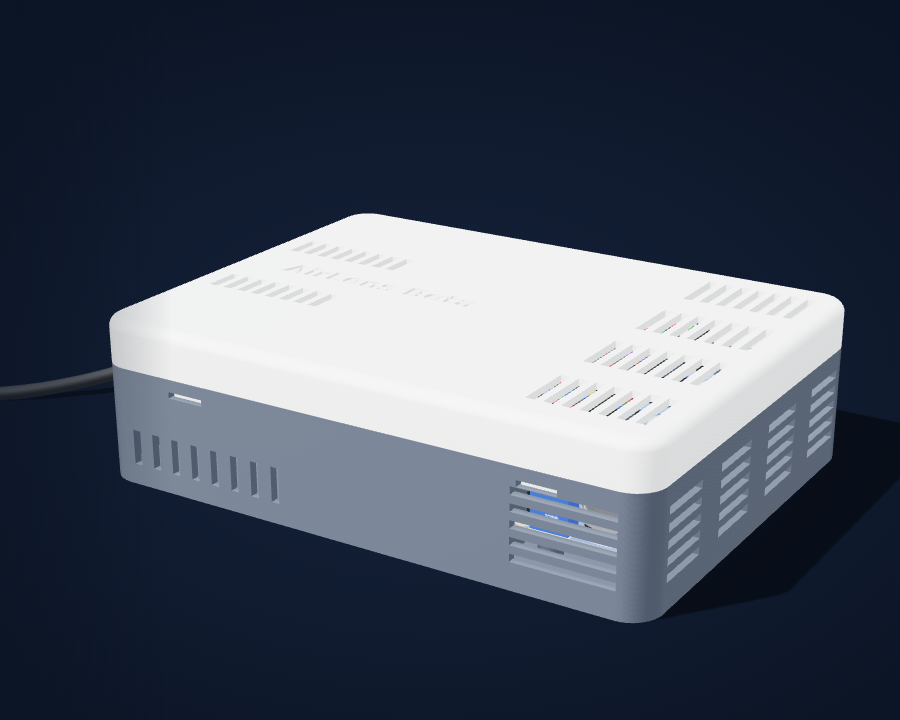
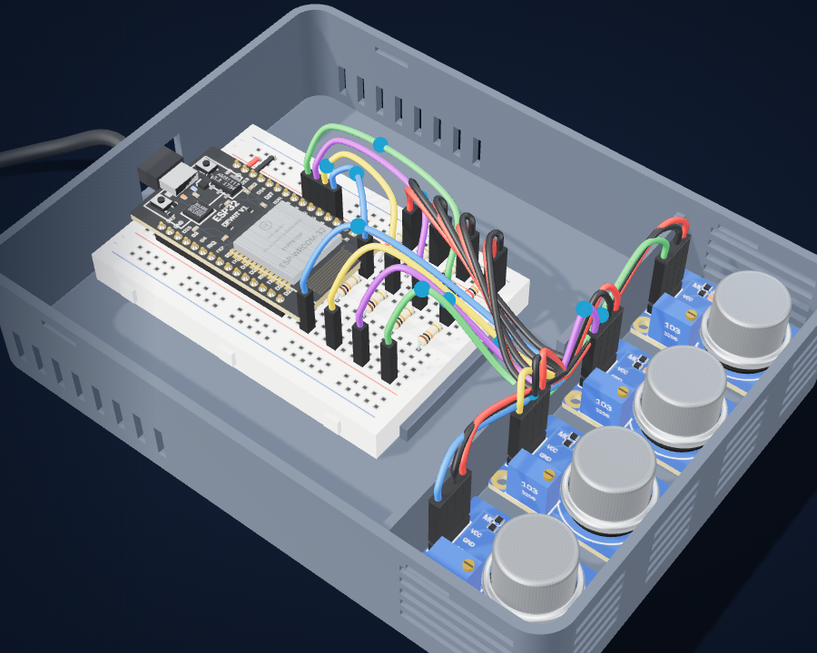

# Kotak versi Beta

Kotak cetak 3D untuk ESP32 DevKit V1 di breadboard 400 lubang + empat modul MQ (MQ-2, MQ-3, MQ-7, MQ-135; revisi Beta SHAP). Ukuran luarnya 150 × 112 × 42 mm dan terdiri dari dua bagian: nampan dan tutup jepit.

| Tertutup | Tutup dilepas |
|---|---|
|  |  |

Gambar dibuat dari model 3D halaman Product (`web/static/product/`), dengan casing dari STL di folder ini.

- Ruang sensor dipisah sekat dari ESP32, karena empat pemanas MQ (±600 mA) menghangatkan udara di sekitarnya.
- Empat MQ berjajar di ruang sensor, masing-masing di atas dua penyangga M3. Ada kisi di ujung (satu kelompok di depan
  tiap modul), kisi di dua sisi, dan empat kelompok kisi di tutup, supaya udara ruangan sampai ke setiap sensor.
- Celah micro-USB 14 × 11 mm di dinding -X. Breadboard menempel ke dinding itu, jadi mulut port ESP32 hanya ±2,5 mm dari
  dinding dalam dan kabel micro-USB biasa masuk penuh (revisi 2026-11-22; sebelumnya port terbenam ±18 mm).
- Ruang ESP32 punya jalur udara sendiri: kisi tegak rendah di kedua dinding samping (masuk) dan dua kelompok kisi pendek
  di tutup, mengapit tulisan ukir (keluar). Celah kabel di atas sekat disumbat busa setelah kabel terpasang, supaya
  panas ESP32 keluar ke atas dan tidak mengalir ke ruang sensor.
- Rusuk penahan breadboard dan penyangga MQ setinggi 9 mm memberi ruang untuk pin di bawah papan.
- Cara dan pengaturan cetak: lihat "File untuk cetak 3D" di bawah.

## File untuk cetak 3D

Kumpulkan **dua file STL** ini (dari folder `hardware/enclosure-beta/stl/`) dan kirim ke printer/jasa cetak:

| File | Bagian | Posisi di bed | Support |
|---|---|---|---|
| `stl/airlens_beta_base.stl` | Nampan (150 × 112 × 30 mm): sekat panas, penyangga MQ, rusuk breadboard, celah USB, semua kisi samping | Seperti apa adanya: lantai nampan di bed | Tidak perlu |
| `stl/airlens_beta_lid.stl` | Tutup jepit (150 × 112 × 18 mm termasuk bibir 6 mm): kisi sensor, kisi ruang ESP32, tulisan ukir "AirLens Beta" | **Dibalik**: permukaan atas tutup menempel di bed, bibir menghadap ke atas | Tidak perlu |

- Jasa cetak yang meminta format CAD: kirim versi STEP dari `step/` (`airlens_beta_base.step`, `airlens_beta_lid.step`).
  STEP juga dipakai untuk mengubah desain di Fusion 360 atau FreeCAD.
- **Jangan** kirim file lain: `beta_case.py` adalah sumber desain, sedangkan GLB di `web/` hanya untuk tampilan website.
- Pengaturan: PETG (lebih tahan panas pemanas MQ) atau PLA, lapisan 0,2 mm, dinding 3, isi 20 %, nozzle 0,4 mm.
  Jembatan terpanjang: celah USB 14 mm dan kisi samping sensor 26 mm; PETG/PLA biasa sanggup tanpa support.
- Perlengkapan tambahan: 8 sekrup M3 × 6 mm self-tapping (2 per modul MQ, masuk ke lubang 2,6 mm di penyangga) dan
  sepotong busa (±15 × 10 mm) untuk menyumbat celah kabel di atas sekat.
- **Sebelum mencetak, ukur komponen asli**: jarak lubang modul MQ (desain: 24 mm, di garis tengah papan), ukuran
  breadboard (83 × 55 mm), dan posisi port micro-USB ESP32. Bila berbeda, ubah konstanta di `beta_case.py`
  (`MQ_X`, `MQ_Y`, `BB_X`, `ESP_Y`), lalu buat ulang STL (bagian di bawah). Modul MQ dari penjual berbeda kadang
  punya posisi lubang berbeda.

## Membuat ulang

Tanpa memasang Python di host, di container sekali pakai (cadquery 2.5.2, trimesh 4.5.3; unduhan ±400 MB):

```bash
docker run --rm -u 0 -v "$PWD:/w" -w /w/hardware/enclosure-beta python:3.12.14-slim-bookworm sh -c '
  apt-get update -qq && apt-get install -y -qq --no-install-recommends libgl1 libglib2.0-0 libxrender1 fonts-dejavu-core fontconfig
  pip install -q "cadquery==2.5.2" "trimesh==4.5.3"
  python beta_case.py && python beta_assemble.py
  chown -R 1000:1000 /w/hardware/enclosure-beta /w/web/static/product/models'
```

`beta_case.py` menulis STL + STEP. Halaman Product memakai STL ini langsung: salin
`stl/airlens_beta_base.stl` dan `stl/airlens_beta_lid.stl` ke `web/static/product/models/`. (`beta_assemble.py` dan GLB-nya
tidak lagi dipakai halaman mana pun.) Font DejaVu dibutuhkan untuk tulisan ukir di tutup.
