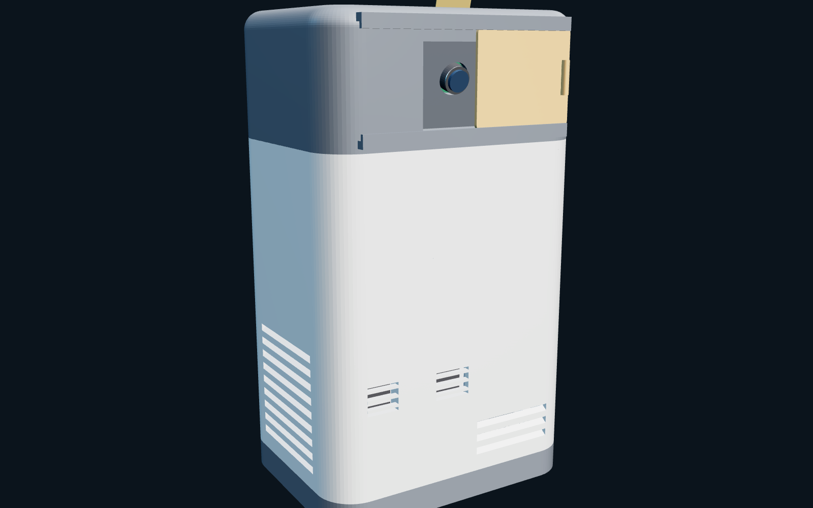

# Casing konsep utama (dalam ruangan)

Casing untuk node lengkap: Raspberry Pi 5 + AI HAT+, Camera Module 3 Wide, SEN66, serta CO-B4 + ISB + ADS1115. Ukuran luarnya 120 × 90 × 205 mm, dicetak dengan PETG. Alasan desain dan prinsip termalnya dijelaskan di [docs/AIRLENS_KONSEP_UTAMA.md](../../docs/AIRLENS_KONSEP_UTAMA.md#10-casing-konsep-utama).



| Bagian | File | Fungsi |
|---|---|---|
| base | `stl/airlens_concept_base.stl` | Alas: kantong kaki karet, lantai berkisi di bawah sel CO, sekrup selubung dari bawah |
| spine | `stl/airlens_concept_spine.stl` | Rangka: dudukan SEN66, nampan ISB + ADS1115, sekat ganda, penyangga Pi 5 (58 × 49, M2.5) |
| sleeve | `stl/airlens_concept_sleeve.stl` | Selubung: kisi sensor bawah/samping, corong SEN66 bergasket, kisi udara Pi di belakang, soket USB-C, lubang gantung |
| cap | `stl/airlens_concept_cap.stl` | Kepala kamera: kantong lensa miring 15°, boss M2 kamera, rel penutup lensa, kisi buang panas |
| shutter | `stl/airlens_concept_shutter.stl` | Penutup lensa geser |
| wall_bracket | `stl/airlens_concept_wall_bracket.stl` | Gantungan dinding (opsional) |

File `step/` dipakai untuk diubah di CAD lain. Pengaturan cetak dan urutan pasang ada di modul perakitan [langkah 11](../../docs/modules/merakit-node-lengkap.html).

## Membuat ulang

```bash
pip install cadquery trimesh
python3 enclosure_concept.py      # STL + STEP ke stl/ dan step/
python3 assemble.py               # rakitan GLB + placements.json ke web/static/product/models/
```

Ukuran modul diambil dari lembar data. Bila modul asli berbeda, ubah konstanta di bagian atas `enclosure_concept.py` (`W`, `D`, `Z_DIV0`, `Z_DIV1`, `Z_TOP`, `TILT`, posisi dudukan), lalu jalankan ulang kedua skrip.
